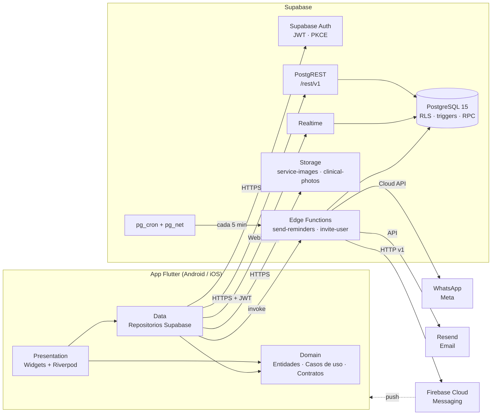
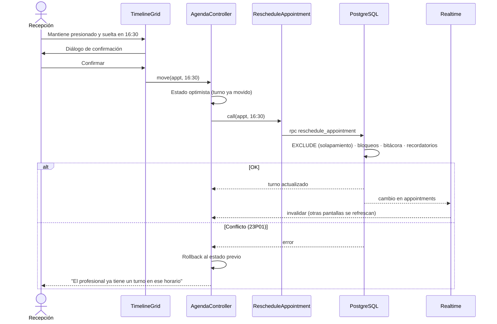
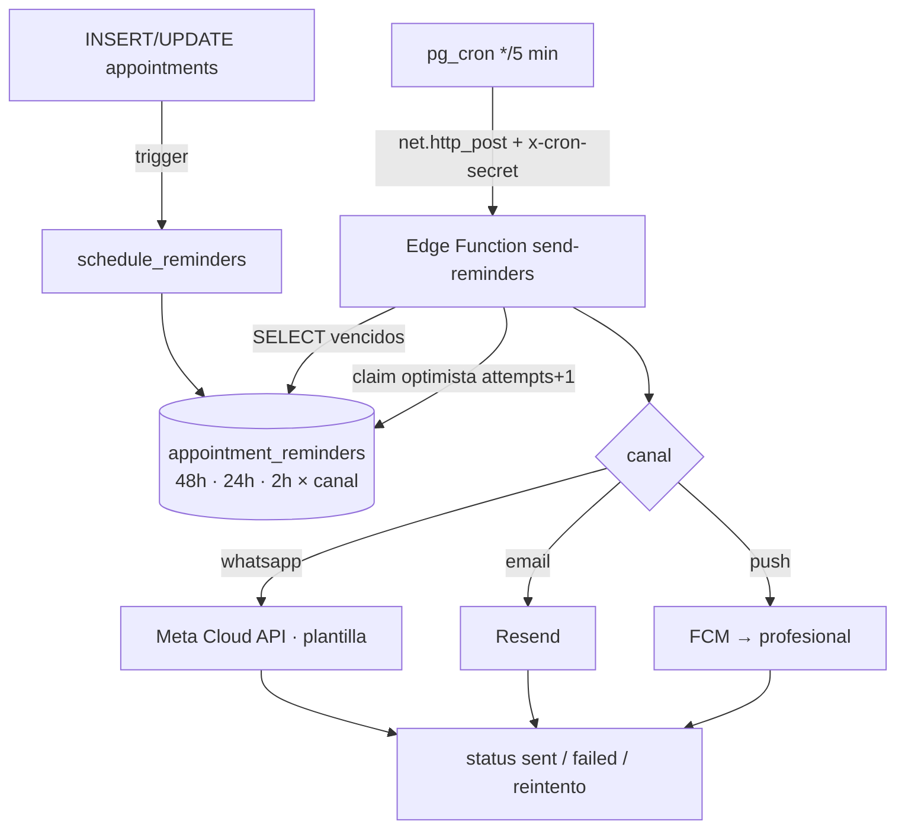

# 2. Arquitectura del sistema

## 2.1 Vista general



### Decisiones clave

| Decisión | Motivo |
|---|---|
| **PostgREST + RPC en lugar de un backend REST propio** | Supabase expone cada tabla/vista/función como endpoint REST seguro. Evita mantener un servidor, y las reglas de negocio críticas viven en la base (una sola fuente de verdad, imposible de saltear desde un cliente modificado). |
| **Reglas críticas en PostgreSQL** | Solapamiento (`EXCLUDE USING gist`), máquina de estados, precios por defecto, bitácora, recordatorios y permisos (RLS). La app valida para dar feedback rápido; la base garantiza. |
| **Edge Functions solo donde hace falta un secreto** | Tokens de WhatsApp, Resend y FCM nunca llegan al dispositivo. |
| **`center_id` en todas las entidades** | Preparado para multi-sede/SaaS sin migración. |
| **Realtime** | La agenda de recepción y la del profesional se sincronizan al instante. |
| **Riverpod sin generación de código** | Menos fricción de build; `AsyncNotifier` para estados con mutaciones (agenda con drag & drop optimista). |

## 2.2 Clean Architecture en Flutter

```
features/<módulo>/
├── domain/          ← Dart puro: entidades, contratos de repositorio, casos de uso
│   ├── entities/
│   ├── repositories/   (abstract interface class)
│   └── usecases/
├── data/            ← Implementaciones con supabase_flutter + mappers fila↔entidad
└── presentation/    ← Providers de Riverpod, páginas y widgets
```

**Regla de dependencias:** `presentation → domain ← data`. El dominio no importa Flutter de UI ni Supabase. Los repositorios se inyectan por providers (`appointmentRepositoryProvider`, etc.), lo que permite reemplazarlos por mocks en tests (`ProviderScope(overrides: [...])`).

Los casos de uso (`CreateAppointment`, `RescheduleAppointment`, `CancelAppointment`) concentran reglas que no dependen de la UI: no agendar en el pasado, motivo obligatorio al cancelar, motivo tras 3 reprogramaciones.

### Flujo de una reprogramación por arrastre



## 2.3 Seguridad

| Capa | Mecanismo |
|---|---|
| Autenticación | Supabase Auth, PKCE, refresh token rotativo, confirmación de email, contraseña robusta |
| Autorización | RLS en **todas** las tablas (`force row level security`). Helpers `SECURITY DEFINER` (`current_center_id`, `has_role`, `therapist_has_client`) evitan recursión |
| Escalada de privilegios | Trigger `protect_profile`: un no-admin no puede cambiar rol, centro ni estado. El rol nunca se toma de `raw_user_meta_data` |
| Profesionales | Trigger `appointment_therapist_guard`: solo pueden cambiar estado y notas de sus turnos |
| Archivos | Bucket clínico privado con ruta `{center}/{client}/…` validada en políticas; URLs firmadas temporales |
| Secretos | Solo en Supabase (Vault / secrets de Edge Functions). La app usa la anon key pública |
| Auditoría | `audit_log` para clientes, pagos, fichas, perfiles y servicios; `appointment_events` para la agenda |
| Transporte | HTTPS/WSS; en Android `usesCleartextTraffic=false` |

## 2.4 Pipeline de recordatorios



Idempotencia: cada recordatorio es único por `(turno, canal, anticipación)`; el "claim" condicionado a `attempts` evita envíos duplicados si dos ejecuciones se solapan.

## 2.5 Estructura de carpetas

```
agenda-wellness/
├── app/                                  Flutter
│   ├── lib/
│   │   ├── main.dart                     Bootstrap (Supabase, intl, push, prefs)
│   │   ├── app.dart                      MaterialApp.router, tema, locales
│   │   ├── core/
│   │   │   ├── config/env.dart           --dart-define
│   │   │   ├── errors/failure.dart       Traducción de errores Postgres/Auth
│   │   │   ├── notifications/            FCM
│   │   │   ├── router/                   go_router + shell adaptativo
│   │   │   ├── supabase/                 Providers del cliente
│   │   │   ├── theme/                    Colores, tema M3, modo oscuro
│   │   │   ├── utils/                    Formateadores es-AR, validadores
│   │   │   └── widgets/                  AsyncValueView, EmptyState…
│   │   └── features/
│   │       ├── auth/        domain · data · presentation (login, registro, recuperación)
│   │       ├── clients/     CRUD, ficha, historia clínica, selector
│   │       ├── services/    CRUD, historial de precios, combos
│   │       ├── agenda/      entidades, casos de uso, grilla drag & drop, formularios
│   │       ├── payments/    registro de cobros
│   │       ├── dashboard/   KPIs y gráficos
│   │       ├── reports/     reportes + exportación PDF/Excel
│   │       └── settings/    preferencias, equipo, notificaciones
│   ├── test/unit/
│   └── env/*.example.json
├── supabase/
│   ├── config.toml
│   ├── migrations/      0001 esquema · 0002 triggers · 0003 RLS · 0004 RPC · 0005 storage/cron
│   ├── functions/       send-reminders · invite-user · _shared
│   ├── tests/           pgTAP
│   └── seed.sql
├── docs/
└── .github/workflows/   ci.yml · deploy.yml
```
