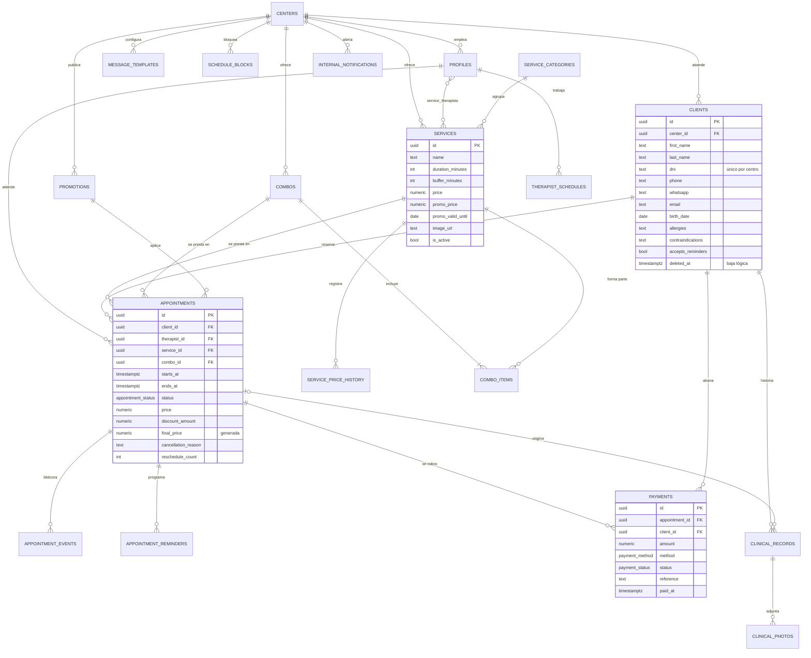

# 3. Modelo de datos

Scripts completos en [`supabase/migrations`](../supabase/migrations) y datos iniciales en [`supabase/seed.sql`](../supabase/seed.sql).

## 3.1 Diagrama entidad-relación

## 3.2 Diccionario de datos

### Enumerados
| Tipo | Valores |
|---|---|
| `user_role` | `admin`, `receptionist`, `therapist` |
| `appointment_status` | `pending`, `confirmed`, `completed`, `cancelled`, `no_show` |
| `payment_method` | `cash`, `transfer`, `card`, `mercado_pago` |
| `payment_status` | `pending`, `paid`, `refunded`, `void` |
| `notification_channel` | `whatsapp`, `email`, `push` |
| `reminder_status` | `scheduled`, `sent`, `failed`, `skipped` |
| `appointment_event` | `created`, `updated`, `rescheduled`, `cancelled`, `confirmed`, `completed`, `no_show` |

### Tablas

| Tabla | Propósito | Claves / restricciones destacadas |
|---|---|---|
| `centers` | Datos del centro, horario y zona horaria | `slot_minutes` ∈ {5,10,15,30,60} |
| `profiles` | Staff (1:1 con `auth.users`) | rol, color en agenda, `fcm_tokens[]`, `is_active` |
| `therapist_schedules` | Horario laboral semanal | único (profesional, día, inicio) |
| `schedule_blocks` | Vacaciones, feriados, licencias | `therapist_id` null = todo el centro |
| `clients` | Clientes | DNI único por centro (parcial, excluye archivados); `search_vector` FTS + índice trigram |
| `service_categories` | Masajes, Estética facial, Complementarios | único (centro, nombre) |
| `services` | Catálogo | `promo_price < price`; duración 5–480 min |
| `service_therapists` | Profesionales habilitados por servicio | PK compuesta |
| `service_price_history` | Auditoría de precios | lo llena un trigger |
| `combos` / `combo_items` | Paquetes con precio cerrado | `on delete restrict` sobre servicios |
| `promotions` | Descuentos % o fijos con vigencia | % ≤ 100; código único por centro |
| `appointments` | Turnos | **`EXCLUDE USING gist (therapist_id =, tstzrange &&) WHERE status IN (pending, confirmed)`** |
| `appointment_events` | Bitácora de cambios | estado y horario anterior/nuevo, motivo, usuario |
| `payments` | Cobros | monto > 0; pagos parciales |
| `clinical_records` | Evaluaciones | escala de dolor 0–10 |
| `clinical_photos` | Fotos de seguimiento | `storage_path` en bucket privado |
| `message_templates` | Plantillas por canal y anticipación | único (centro, canal, horas) |
| `appointment_reminders` | Cola de envíos | único (turno, canal, horas); índice parcial de pendientes |
| `internal_notifications` | Campana de la app | `user_id` null = todo el staff |
| `audit_log` | Auditoría genérica | JSON antes/después |

### Vistas
| Vista | Uso |
|---|---|
| `appointments_view` | Turno + nombre de cliente, profesional, servicio, colores y monto pagado (una sola consulta para la agenda). `security_invoker` → respeta RLS |
| `client_stats` | Asistencias, cancelaciones, ausencias, próximos, gasto total, última y próxima visita |

### Funciones (RPC)
| Función | Descripción |
|---|---|
| `cancel_appointment(id, reason)` | Cancela con motivo obligatorio |
| `reschedule_appointment(id, new_start, new_therapist?, reason?)` | Mueve conservando duración; error `P0409` si hay solapamiento |
| `set_appointment_status(id, status)` | Aplica la máquina de estados |
| `available_slots(date, service_id, therapist_id?)` | Huecos libres según horario laboral, turnos y bloqueos |
| `suggest_reschedule(appointment_id, days?, limit?)` | Huecos sugeridos tras una cancelación |
| `dashboard_summary(from?, to?)` | Todos los KPIs en un JSON |
| `report_sales / report_appointments / report_services / report_clients / report_cancellations` | Datos de reportes |
| `admin_update_user(user_id, role, active)` | Gestión de equipo |
| `register_fcm_token(token)` | Registro del dispositivo para push |

### Triggers
| Trigger | Efecto |
|---|---|
| `on_auth_user_created` | Crea el perfil; primer usuario = admin; resto inactivo |
| `protect_profile` | Evita escalada de privilegios |
| `appointment_before` | Defaults de precio/duración, validación de profesional y bloqueos, timestamps de estado |
| `appointment_after` | Bitácora, recordatorios, notificación de cancelación |
| `appointment_therapist_guard` | Limita lo que un profesional puede modificar |
| `service_price_history` | Historial de precios |
| `client_after_insert` | Notificación "cliente nuevo" |
| `audit` | Auditoría en tablas sensibles |

### Tareas programadas (pg_cron)
| Job | Frecuencia | Acción |
|---|---|---|
| `dispatch-reminders` | cada 5 min | Invoca la Edge Function `send-reminders` |
| `notify-upcoming` | cada 5 min | Alerta al profesional 30 min antes |
| `auto-no-show` | cada hora | Marca Ausente turnos no cerrados 3 h después |

## 3.3 Agregados en v1.1

| Tabla / columna | Propósito |
|---|---|
| `centers.logo_url`, `description`, `whatsapp_contact`, `instagram`, `website` | Marca y contacto público |
| `centers.telegram_bot_username`, `telegram_admin_chat_id`, `telegram_channel_id` | Configuración de Telegram |
| `centers.public_catalog_enabled`, `backup_enabled` | Interruptores |
| `clients.telegram_chat_id`, `telegram_username`, `telegram_linked_at`, `telegram_link_code` | Vinculación con Telegram (código único que rota al usarse) |
| `products` | Productos de la vitrina: precio, promo, stock opcional, destacado |
| `promo_posts` | Publicaciones promocionales con vigencia, imagen y vínculo a servicio/combo/producto |
| `backups` | Historial de backups: proveedor, estado, tamaño, filas, cifrado |
| `private.integration_secrets` | Refresh tokens que rotan (OneDrive). Esquema no expuesto por la API |
| Enum `notification_channel` + `telegram` | Nuevo canal de recordatorio |
| Buckets `branding`, `showcase` | Públicos de lectura, escritura solo admin dentro de la carpeta del centro |
| RPC `public_catalog`, `public_branding` | Únicas funciones accesibles sin login |
| Job `daily-cloud-backup` | 06:00 UTC (03:00 ART) |
