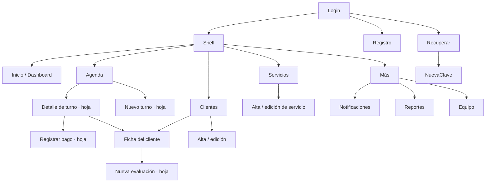

# 5. Diseño UX/UI y wireframes

## 5.1 Principios

1. **La agenda es el corazón.** Todo está a ≤ 2 toques de crear o mover un turno.
2. **Calma visual.** Paleta de spa, mucho aire, tipografía serif en títulos; el color se reserva para estados y alertas.
3. **Seguridad del cliente primero.** Alergias y contraindicaciones aparecen en naranja en la ficha, en el buscador y al agendar.
4. **Nada depende solo del color.** Cada estado tiene color + ícono + texto.
5. **Una mano.** Acciones principales abajo (FAB, barra de navegación, hojas modales).
6. **Feedback inmediato.** Drag & drop optimista, háptica al cambiar de franja, snackbars de confirmación, skeletons al cargar.

Inspiración: la claridad de calendario de **Calendly**, las tarjetas de servicio de **Fresha/Treatwell** y la jerarquía de reservas de **Booking**.

## 5.2 Sistema de diseño

### Color

| Token | Claro | Uso |
|---|---|---|
| `sage` (semilla M3) | `#5E7D6F` | Primario: botones, selección, navegación |
| `sageLight` | `#A8C3B8` | Superficies tonales |
| `sand` | `#F4EFE6` | Fondo (modo claro) |
| `terracotta` | `#C98B6B` | Secundario: promos, línea de "ahora", pico de demanda |
| `ink` | `#26332E` | Texto principal |
| `night` | `#151C19` | Fondo (modo oscuro) |

Estados: Pendiente `#E0A245` · Confirmado `#4F8A8B` · Completado `#5F9A62` · Cancelado `#C0605F` · Ausente `#8C879B`.

El esquema completo se genera con `ColorScheme.fromSeed` (Material 3), lo que asegura contraste AA en claro y oscuro.

### Tipografía
- **Fraunces** (serif suave) para titulares y saludo.
- **DM Sans** para cuerpo, datos y números.

### Forma y espaciado
- Radios 16 px (tarjetas, inputs, botones), 28 px (hojas modales), 10 px (bloques de turno).
- Grilla de 4 px; márgenes laterales 16 px; botones de 52 px de alto.
- Elevación 0 en tarjetas (se separan por tono, no por sombra); el turno arrastrado sube a elevación 8.

### Movimiento
- Transición *fade-forwards* en Android y Cupertino en iOS.
- Barras del ranking de servicios crecen con `easeOutCubic` (600 ms).
- Gráfico de facturación anima entre períodos (400 ms).

## 5.3 Mapa de navegación



En pantallas ≥ 840 px (tablet en recepción) la barra inferior se convierte en **NavigationRail** lateral y la grilla de agenda muestra más columnas.

## 5.4 Wireframes

### Login
```
┌──────────────────────────────┐
│                              │
│           ╭──────╮           │
│           │  🌿  │           │
│           ╰──────╯           │
│       Agenda Wellness        │
│ Ingresá para gestionar tu    │
│           centro             │
│                              │
│  ┌────────────────────────┐  │
│  │ ✉  Email               │  │
│  └────────────────────────┘  │
│  ┌────────────────────────┐  │
│  │ 🔒 Contraseña       👁 │  │
│  └────────────────────────┘  │
│         ¿Olvidaste tu clave? │
│  ┌────────────────────────┐  │
│  │       Ingresar         │  │
│  └────────────────────────┘  │
│   ¿No tenés cuenta? Registrate│
└──────────────────────────────┘
```

### Dashboard
```
┌──────────────────────────────┐
│ Buen día, Carla          🔔  │
│ Martes 10 de noviembre       │
│ [7 días][Este mes][90 d][Año]│
│ ┌────────────┐┌────────────┐ │
│ │📅          ││💵          │ │
│ │ 14         ││ $187.000   │ │
│ │Turnos hoy  ││Facturación │ │
│ └────────────┘└────────────┘ │
│ ┌────────────┐┌────────────┐ │
│ │📈 $1,8 M   ││👤 9        │ │
│ │Período     ││Nuevos      │ │
│ └────────────┘└────────────┘ │
│ PRÓXIMOS TURNOS DE HOY       │
│ ▌16:00  Ana Pérez     ◷Pend. │
│ ▌       Relajante · Laura    │
│ ▌17:00  Juan Gómez    ✓Conf. │
│ FACTURACIÓN DIARIA           │
│ ╭────────────────────────╮   │
│ │    ╱╲    ╱╲__╱‾‾╲      │   │
│ │ __╱  ╲__╱        ╲_    │   │
│ ╰────────────────────────╯   │
│ SERVICIOS MÁS VENDIDOS       │
│ Descontracturante  38 ██████ │
│ Relajante          31 █████  │
├──────────────────────────────┤
│ 🏠   📅   👥   🌿   ☰        │
└──────────────────────────────┘
```

### Agenda · vista diaria (columna por profesional)
```
┌──────────────────────────────┐
│ Agenda                 📅  ⋮ │
│  ‹   Martes 10 de noviembre ›│
│ [ Día ][ Semana ][ Mes ]     │
│ (Todos)(● Laura)(● Sofía)    │
├──────┬────────────┬──────────┤
│      │ ● Laura    │ ● Sofía  │
│      │ 5 turnos   │ 3 turnos │
├──────┼────────────┼──────────┤
│09:00 │┃09:00–10:00│          │
│      │┃Ana Pérez ◷│          │
│10:00 │┃Relajante  │┃10:00 ✓  │
│      │            │┃Juan G.   │
│11:00 │   ┌ ─ ─ ─ ┐│┃Facial   │
│      │   │ 11:15  ││          │ ← fantasma al arrastrar
│12:00 │   └ ─ ─ ─ ┘│          │
│ ●━━━━━━━━━━━━━━━━━━━━━━━━━━━ │ ← línea de “ahora”
│13:00 │            │          │
│      │       toque en hueco → nuevo turno
│                       [+ Turno]│
└──────────────────────────────┘
```
Interacción: **mantener presionado** un turno (350 ms) → se eleva → al moverlo aparece el fantasma con la hora ajustada a 15 min y vibración en cada cambio → soltar → diálogo "Reprogramar turno: 10/11 09:00 → 10/11 11:15".

### Agenda · vista mensual
```
┌──────────────────────────────┐
│  ‹      Noviembre 2026     › │
│  L   M   M   J   V   S   D   │
│                          1   │
│  2   3   4   5   6   7   8   │
│  ••  •••  •   ••  ••••       │
│  9  (10) 11  12  13  14  15  │
│ •••  ••  ••                  │
├──────────────────────────────┤
│ Martes 10 de noviembre  Ver día│
│ ◷ Ana Pérez   16:00 Relajante│
│ ✓ Juan Gómez  17:00 Facial   │
└──────────────────────────────┘
```

### Nuevo turno (hoja modal)
```
┌──────────────────────────────┐
│ Nuevo turno               ✕  │
│ CLIENTE                      │
│ ┌ 👤 Ana Pérez · 3764…   › ┐ │
│ ⚠ Alergias: aceite almendras │
│ SERVICIO      [Servicio|Combo]│
│ (● Descontracturante · 1 h)  │
│ (● Relajante · 1 h) (● …)    │
│ PROFESIONAL                  │
│ (● Laura) (● Sofía)          │
│ FECHA Y HORA                 │
│ [📅 Mar 10 nov] [🕒 16:00]   │
│ Horarios disponibles         │
│ (15:00)(15:15)(16:00)(16:15) │
│ PRECIO                       │
│ Precio            $25.000    │
│ Descuento   [$ 0         ]   │
│ ─────────────────────────    │
│ Total             $25.000    │
│ [Notas del turno           ] │
│ Marcar como confirmado  ( o) │
│ [      ✓ Agendar turno     ] │
└──────────────────────────────┘
```

### Detalle de turno (hoja modal)
```
┌──────────────────────────────┐
│ Masaje Relajante   ◷Pendiente│
│ Martes 10 de nov · 16:00–17:00│
│ ┌──────────────────────────┐ │
│ │ (AP) Ana Pérez   💬  🪪  │ │
│ │ ● Laura · Profesional    │ │
│ │ 💵 $25.000   Saldo $25.000│ │
│ └──────────────────────────┘ │
│ CAMBIAR ESTADO               │
│ (✓ Confirmar asistencia)     │
│ (☑ Marcar completado)(Ausente)│
│ [ 🧾 Registrar pago $25.000 ]│
│ [ ↻ Reprogramar            ] │
│ [ ✕ Cancelar turno         ] │
└──────────────────────────────┘
```
Al cancelar: chips de motivo frecuente + campo libre → luego hoja "¿Querés ofrecerle uno de estos horarios libres?".

### Ficha del cliente
```
┌──────────────────────────────┐
│ ‹ Ana Pérez            ✎  ⋮  │
│ [Resumen][Turnos][Ficha clínica][Pagos]
│ ┌ ⚠ Alertas de salud ──────┐ │
│ │ Alergias: aceite almendras│ │
│ └──────────────────────────┘ │
│ ┌────┐┌────┐┌────┐┌──────┐   │
│ │ 12 ││ 1  ││ 0  ││$310 k│   │
│ │Asis││Canc││Aus.││Gastó │   │
│ └────┘└────┘└────┘└──────┘   │
│ Próximo turno: Jue 12 · 18:00│
│ CONTACTO                     │
│ 💬 3764 123456  WhatsApp   ↗ │
│ ✉ ana@mail.com             ↗ │
│                  [📅 Agendar]│
└──────────────────────────────┘
```

### Servicios
```
┌──────────────────────────────┐
│ Servicios                    │
│ MASAJES                      │
│ ┌────┬─────────────────────┐ │
│ │img │Descontracturante (●)│ │
│ │    │🕒 1 h       $28.000 │ │
│ └────┴─────────────────────┘ │
│ ┌────┬─────────────────────┐ │
│ │img │Relajante        (●) │ │
│ │    │🕒 1 h  $25.000 $22k │ │ ← promo tachada
│ └────┴─────────────────────┘ │
│ COMBOS                       │
│ 🎁 Combo Relax      $40.000  │
│ (Relajante)(Yoga Facial)     │
│ 1 h 45 min · Ahorro $5.000   │
│                 [+ Servicio] │
└──────────────────────────────┘
```

### Reportes
```
┌──────────────────────────────┐
│ ‹ Reportes                   │
│ (Ventas)(Turnos)(Servicios)… │
│ [📅 01/11/2026 – 10/11/2026] │
│ [Día][Semana][Mes][Año]      │
│ Período │Cobros│Efectivo│Total│
│ 01/11   │  12  │ 80.000 │210k │
│ 02/11   │   9  │ 45.000 │160k │
│ …                            │
│ [ ▦ Excel ]   [ ⎙ PDF ]      │
└──────────────────────────────┘
```

## 5.5 Accesibilidad
- Objetivos táctiles ≥ 48 px; `tooltip` en todos los íconos de acción.
- Escala de texto del sistema respetada (layouts con `FittedBox`/`ellipsis` donde corresponde).
- Contraste AA garantizado por `ColorScheme.fromSeed`.
- Estados con ícono y texto además de color; tachado para cancelados.
- `AutofillGroup` en login para gestores de contraseñas.
