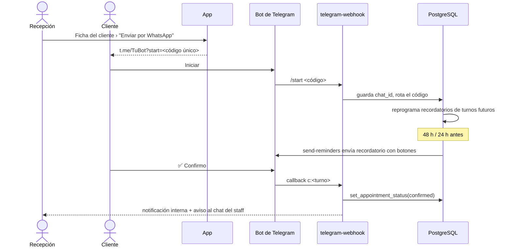

# 7. Telegram, web de administración, backups, logo y vitrina

Este documento cubre los módulos agregados en la versión 1.1 y cómo configurarlos en producción.

| Módulo | Qué hace | Dónde está |
|---|---|---|
| Telegram | Recordatorios con botones **Confirmo / Reprogramar / Cancelar**, avisos al staff y publicación de promociones en un canal | `functions/telegram-webhook`, `functions/telegram-broadcast`, `send-reminders` |
| Web de administración | La misma app compilada para navegador; **solo administradores** pueden ingresar | `flutter build web`, `firebase.json` |
| Backups | Copia diaria **cifrada** de toda la base a **Google Drive** (u OneDrive), con retención y restauración | `functions/backup`, `scripts/restore-backup.ts` |
| Logo | Carga del logo del centro; se usa en login, dashboard, PDF, emails y catálogo | Más › Datos del centro |
| Vitrina | Productos y promociones; catálogo público para clientes y difusión por WhatsApp/Telegram | Pestaña **Catálogo**, ruta pública `/catalogo` |

Migraciones nuevas: `0006_telegram_enum`, `0007_telegram_branding_showcase_backups`, `0008_backup_cron`.

---

## 7.1 Telegram

### Cómo funciona



- **Confirmo** → el turno pasa a *Confirmado*.
- **Reprogramar** → se registra el pedido, el staff recibe un aviso y el cliente ve "te vamos a escribir con nuevos horarios".
- **Cancelar** → pide confirmación ("¿Seguro?") y cancela con motivo *Cancelado por el cliente vía Telegram*; el horario queda libre y se notifica al profesional.
- El recordatorio de **2 h** antes se envía sin botones (solo aviso).
- Cada botón verifica que el chat que lo toca sea el del cliente del turno.

### Configuración

1. En Telegram, hablar con **@BotFather** → `/newbot` → nombre y usuario (ej. `AgendaWellnessBot`). Guardar el **token**.
2. Opcional: `/setuserpic` con el logo y `/setdescription` con un texto de bienvenida.
3. Secretos y deploy:
   ```bash
   supabase secrets set TELEGRAM_BOT_TOKEN='123456:ABC…' TELEGRAM_WEBHOOK_SECRET='<cadena-aleatoria>' \
                        PUBLIC_CATALOG_URL='https://agenda.tucentro.com/catalogo'
   supabase functions deploy telegram-webhook --no-verify-jwt
   supabase functions deploy telegram-broadcast
   ```
4. Registrar el webhook (una sola vez):
   ```bash
   curl "https://api.telegram.org/bot<TOKEN>/setWebhook" \
     -d "url=https://<ref>.supabase.co/functions/v1/telegram-webhook" \
     -d "secret_token=<TELEGRAM_WEBHOOK_SECRET>" \
     -d 'allowed_updates=["message","callback_query"]'
   ```
5. En la app: **Más › Datos del centro › Telegram**
   - *Usuario del bot*: `AgendaWellnessBot`
   - *Chat de avisos al staff* (opcional): crear un grupo con el staff, agregar el bot, y obtener el ID con `https://api.telegram.org/bot<TOKEN>/getUpdates` (número negativo).
   - *Canal de promociones* (opcional): crear un canal, agregar el bot como **administrador** y cargar `@nombredelcanal`.

### Vincular un cliente
Ficha del cliente › **Telegram** › *Enviar por WhatsApp* (o *Copiar enlace*). Al tocar **Iniciar** queda vinculado y recibe su próximo turno con botones. El enlace es de un solo uso; *Nuevo enlace* invalida el anterior y *Desvincular* deja de enviarle mensajes.

---

## 7.2 Web de administración

La web es la **misma app Flutter** compilada para navegador, con diseño adaptativo (menú lateral en pantallas anchas) y agenda con **arrastrar y soltar con el mouse**.

**Acceso solo para administradores**: si una recepcionista o profesional intenta ingresar, se cierra la sesión con el mensaje *"El acceso web es solo para administradores"*. Es una restricción de producto: la seguridad de los datos sigue garantizada por RLS igual que en el móvil.

**La ruta `/catalogo` es pública** (sin login): es el catálogo para compartir con clientes.

### Publicar

```bash
cd app
flutter create . --platforms=web        # solo la primera vez (genera web/)
flutter build web --release --dart-define-from-file=env/prod.json
firebase deploy --only hosting           # usa app/firebase.json (reescritura SPA + headers de seguridad)
```

Alternativas equivalentes: Vercel, Netlify o Cloudflare Pages (configurar *rewrite* de todas las rutas a `/index.html`).

Luego, en Supabase › **Authentication › URL Configuration**, agregar a *Redirect URLs* el dominio web (ej. `https://agenda.tucentro.com`) para que funcionen la recuperación de contraseña y las invitaciones desde el navegador.

Dominio propio en Firebase Hosting: *Hosting › Agregar dominio personalizado* → registros DNS que indica Firebase. El certificado HTTPS es automático.

El job `web` de `.github/workflows/deploy.yml` hace todo esto en cada release (secretos `FIREBASE_SERVICE_ACCOUNT` y `FIREBASE_PROJECT_ID`).

---

## 7.3 Backups en la nube

### Qué se guarda
Un archivo `agenda-wellness-AAAA-MM-DD-HH-MM.zip.enc` con:
- `data/*.json`: todas las tablas (clientes, turnos, pagos, fichas clínicas, servicios, precios, productos, promociones, plantillas, configuración…).
- `auth/users.json`: usuarios del staff (id, email, metadatos; **sin contraseñas**).
- `storage/manifest.json`: lista de fotos clínicas; con `BACKUP_INCLUDE_PHOTOS=true` incluye las fotos.
- `manifest.json`: fecha y cantidad de filas por tabla.

Se ejecuta **todas las noches a las 03:00** (hora Argentina) y se conservan **30 días** (configurable). También se puede lanzar desde **Más › Copias de seguridad › Hacer backup ahora**. Si falla, los administradores reciben una notificación en la app.

> **Cifrado:** el archivo contiene datos de salud. Con `BACKUP_ENCRYPTION_KEY` definido se cifra con AES-256-GCM (clave derivada con PBKDF2, 210.000 iteraciones). Guardá esa clave en un gestor de contraseñas: **sin ella el backup no se puede restaurar**.

### Opción A — Google Drive (recomendada para una cuenta Gmail)

Se usa OAuth con la cuenta del dueño (las *service accounts* de Google no pueden guardar archivos en el Drive de una cuenta personal). El scope es `drive.file`: la app **solo ve los archivos que ella misma crea**, no el resto de tu Drive.

1. **Google Cloud Console** → crear proyecto `agenda-wellness-backup` → *APIs y servicios › Biblioteca* → habilitar **Google Drive API**.
2. *Pantalla de consentimiento de OAuth* → tipo **Externo** → completar nombre y email de soporte → en *Usuarios de prueba* agregar la cuenta donde querés los backups (`avilamaurog@gmail.com`).
3. **Publicar la app** (*Publishing status › In production*). Importante: en modo *Testing* el refresh token vence a los 7 días y los backups dejarían de funcionar. Con el scope `drive.file` no hace falta verificación de Google.
4. *Credenciales › Crear credenciales › ID de cliente de OAuth* → tipo **Aplicación web** → URI de redirección autorizado: `https://developers.google.com/oauthplayground`. Guardar *Client ID* y *Client secret*.
5. Abrir **OAuth 2.0 Playground** (developers.google.com/oauthplayground) → ⚙️ *Use your own OAuth credentials* → pegar Client ID/secret → en el paso 1 escribir el scope `https://www.googleapis.com/auth/drive.file` → *Authorize APIs* → iniciar sesión con la cuenta de los backups → *Exchange authorization code for tokens* → copiar el **Refresh token**.
6. Secretos y deploy:
   ```bash
   supabase secrets set BACKUP_PROVIDER=google_drive \
     GOOGLE_CLIENT_ID='…apps.googleusercontent.com' GOOGLE_CLIENT_SECRET='…' GOOGLE_REFRESH_TOKEN='1//…' \
     BACKUP_ENCRYPTION_KEY='<frase-larga-y-secreta>' BACKUP_RETENTION_DAYS=30
   supabase functions deploy backup --no-verify-jwt
   supabase db push      # aplica 0008_backup_cron (job diario)
   ```
7. Probar desde la app (**Hacer backup ahora**). En tu Drive aparece la carpeta **Agenda Wellness Backups**.

### Opción B — OneDrive (cuenta Microsoft)

1. **Azure Portal › App registrations › New registration** → *Accounts in any organizational directory and personal Microsoft accounts* → Redirect URI (Web): `http://localhost`.
2. *Certificates & secrets* → nuevo client secret. *API permissions* → Microsoft Graph delegado: `Files.ReadWrite`, `offline_access`.
3. Obtener el código: abrir en el navegador
   `https://login.microsoftonline.com/consumers/oauth2/v2.0/authorize?client_id=<ID>&response_type=code&redirect_uri=http://localhost&scope=Files.ReadWrite%20offline_access`
   e iniciar sesión; copiar el `code` de la URL de retorno.
4. Canjearlo por el refresh token:
   ```bash
   curl -X POST https://login.microsoftonline.com/consumers/oauth2/v2.0/token \
     -d client_id=<ID> -d client_secret=<SECRET> -d code=<CODE> \
     -d redirect_uri=http://localhost -d grant_type=authorization_code
   ```
5. Secretos:
   ```bash
   supabase secrets set BACKUP_PROVIDER=onedrive ONEDRIVE_CLIENT_ID='…' ONEDRIVE_CLIENT_SECRET='…' \
     ONEDRIVE_REFRESH_TOKEN='…' BACKUP_ENCRYPTION_KEY='<frase>'
   ```
   Microsoft rota el refresh token en cada uso; la función guarda el último en un esquema privado de la base (`private.integration_secrets`), inaccesible desde la API.

### Restaurar un backup

```bash
# 1. Descargar el archivo desde Drive/OneDrive
# 2. Proyecto destino con migraciones aplicadas (supabase db push)
# 3. Simulación (no escribe nada):
SUPABASE_URL=https://<ref>.supabase.co SUPABASE_SERVICE_ROLE_KEY=<service_role> \
BACKUP_ENCRYPTION_KEY='<frase>' \
deno run -A supabase/scripts/restore-backup.ts agenda-wellness-2026-11-10-06-00.zip.enc --dry-run
# 4. Restaurar: mismo comando sin --dry-run
```

Notas: el script hace *upsert* por id (se puede repetir sin duplicar). Para restaurar `profiles` los usuarios de Auth deben existir con el mismo id (ver `auth/users.json`); si se restaura en un proyecto nuevo, conviene invitar nuevamente al staff. Al reinsertar turnos los triggers generan eventos "creado" adicionales en la bitácora; los recordatorios se reprograman solos para los turnos futuros.

Practicá una restauración en un proyecto de staging una vez por trimestre.

---

## 7.4 Logo y datos del centro

**Más › Datos del centro** (solo administradores):
- **Logo**: PNG/JPG/WebP, idealmente cuadrado 512×512 con fondo transparente. Se guarda en el bucket público `branding` con nombre único (evita caché vieja).
- Nombre, descripción, razón social, CUIT, WhatsApp de reservas, teléfono, email, dirección, Instagram y web.
- Interruptor del catálogo público y del backup diario.
- Configuración de Telegram.

El logo aparece en: pantalla de ingreso (vía la RPC pública `public_branding`), barra del dashboard, encabezado de los reportes PDF, emails de recordatorio y catálogo público.

---

## 7.5 Vitrina: servicios, productos y promociones

La pestaña **Catálogo** reemplaza a *Servicios* y tiene tres secciones:

| Sección | Contenido | Quién edita |
|---|---|---|
| Servicios | El catálogo de servicios y combos de siempre | Admin |
| Productos | Aceites, cremas, kits, gift cards: foto, precio, precio promo, stock opcional, destacado | Admin |
| Promociones | Publicaciones con imagen, texto, vigencia, botón de acción y vínculo a un servicio/combo/producto | Admin |

**Difusión de una promoción**
- **Compartir**: abre el menú del teléfono (WhatsApp, Instagram, estados…) con el texto y el enlace al catálogo.
- **Publicar en Telegram**: la envía al canal del centro con foto, precio, vigencia y botones *Reservar por WhatsApp* y *Ver todos los servicios*.
- **Catálogo público** (`https://tu-dominio/catalogo`): banner con las promociones destacadas y vigentes, servicios por categoría con duración y precio, combos y productos. Cada ítem abre WhatsApp con un mensaje prearmado ("Hola! Quiero reservar Masaje Relajante").

**Privacidad del catálogo público**: no se exponen tablas al rol anónimo. Todo sale de la función `public_catalog()`, que devuelve únicamente ítems activos y vigentes y datos de contacto del centro. Desactivando *Publicar catálogo* la página muestra "Catálogo no disponible".

---

## 7.6 Resumen de secretos nuevos

| Secreto | Para qué |
|---|---|
| `TELEGRAM_BOT_TOKEN` | Bot de Telegram |
| `TELEGRAM_WEBHOOK_SECRET` | Valida que las llamadas al webhook vengan de Telegram |
| `PUBLIC_CATALOG_URL` | Botón "Ver todos los servicios" en Telegram |
| `BACKUP_PROVIDER` | `google_drive` (por defecto) u `onedrive` |
| `GOOGLE_CLIENT_ID`, `GOOGLE_CLIENT_SECRET`, `GOOGLE_REFRESH_TOKEN` | Google Drive |
| `GOOGLE_DRIVE_FOLDER_ID` (opcional) | Usar una carpeta existente en lugar de crearla |
| `ONEDRIVE_CLIENT_ID`, `ONEDRIVE_CLIENT_SECRET`, `ONEDRIVE_REFRESH_TOKEN` | OneDrive |
| `BACKUP_ENCRYPTION_KEY` | Cifrado del archivo (muy recomendado) |
| `BACKUP_RETENTION_DAYS` | Días a conservar (30 por defecto) |
| `BACKUP_INCLUDE_PHOTOS` | `true` para incluir fotos clínicas (archivos más grandes) |
| `BACKUP_FOLDER_NAME` | Nombre de la carpeta (por defecto *Agenda Wellness Backups*) |

En `env/prod.json` de la app: `PUBLIC_CATALOG_URL`.

## 7.7 Checklist

- [ ] Migraciones 0006–0008 aplicadas
- [ ] Bot creado, webhook registrado (`getWebhookInfo` sin errores) y usuario del bot cargado en Datos del centro
- [ ] Prueba: vincular tu propio Telegram como cliente, crear un turno a 3 días y tocar ✅ en el recordatorio
- [ ] Web publicada, dominio en *Redirect URLs* de Supabase, ingreso con usuario admin OK y con recepcionista rechazado
- [ ] Google Drive conectado (app OAuth **en producción**), backup manual OK y archivo visible en Drive
- [ ] `BACKUP_ENCRYPTION_KEY` guardada en un gestor de contraseñas
- [ ] Restauración de prueba en staging con `--dry-run`
- [ ] Logo cargado y visible en login, dashboard y PDF
- [ ] Al menos una promoción destacada y el catálogo público revisado desde un celular
